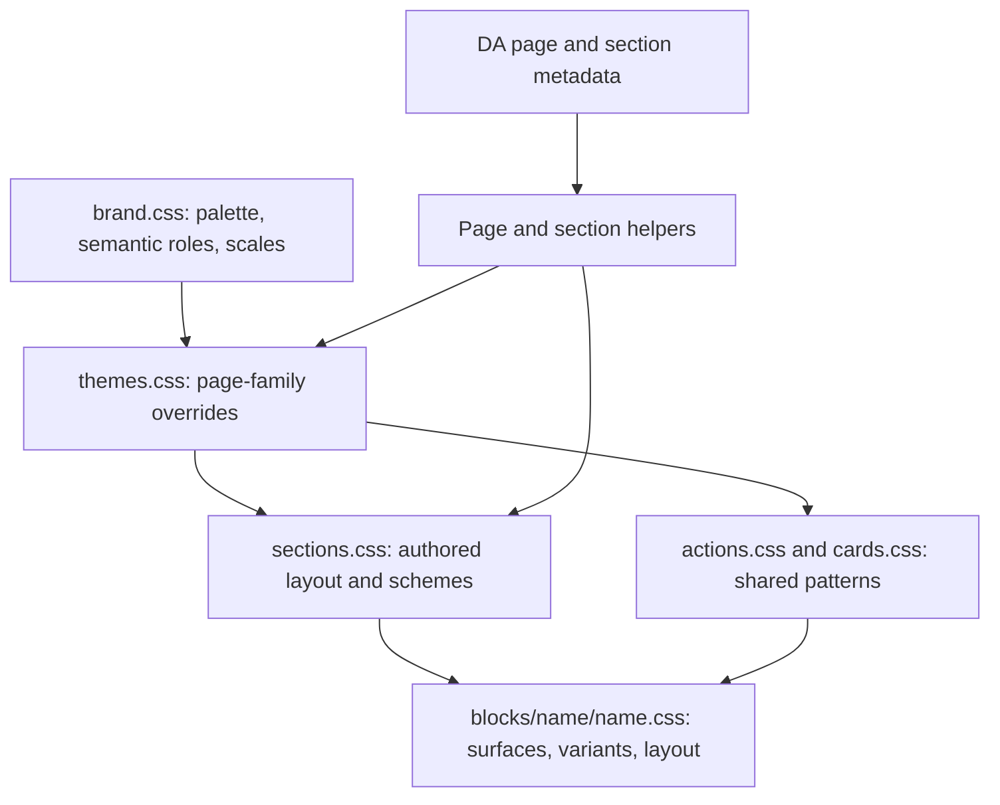

# E*TRADE style system

This guide explains the style system implemented in this repository: how values reach the page, which files own each responsibility, and how to author or extend the system. It describes the current code rather than a proposed architecture.

The system shares design values across blocks while keeping each block responsible for its layout. Authors can select a page design family, configure a section, and choose a block variant independently.

The standard FAQ accordion has a visible page-family treatment: Purple uses deep-purple cards with light text and links; Charcoal uses rounded light-gray cards with dark text. Its Flat variant retains its light divided-row design in both families. These colors use the `--accordion-faq-item-*` roles in `themes.css`.

For authoring, start with [page themes](#page-themes-section-schemes-and-block-variants) and [section controls](#authoring-sections-in-da). For development, start with the [repository map](#repository-map) and [change guidance](#making-a-change).

## Contents

- [How the layers fit together](#how-the-layers-fit-together)
- [Repository map](#repository-map)
- [Tokens and naming](#tokens-and-naming)
- [Page themes, section schemes, and block variants](#page-themes-section-schemes-and-block-variants)
- [Authoring sections in DA](#authoring-sections-in-da)
- [Responsive layout and typography](#responsive-layout-and-typography)
- [Shared cards and actions](#shared-cards-and-actions)
- [How the page loads](#how-the-page-loads)
- [Making a change](#making-a-change)
- [Troubleshooting](#troubleshooting)
- [Validation and rollout](#validation-and-rollout)

## How the layers fit together

A palette value identifies a color. A semantic token describes its purpose. A page family can change that semantic value. A section chooses an inherited color scheme and outer layout. A block consumes these values and owns its internal presentation.

For example, `--palette-purple-900` is `#241056`. The Purple page family maps `--color-surface-inverse` to that value. A section authored with `Color Scheme: dark` uses the inverse surface. An ordinary light card in that section keeps its own light surface, dark text, and purple links.



This diagram shows responsibilities. It is not a CSS priority ladder: normal inheritance, selector specificity, and source order still determine the result. A block that paints its own surface must also provide readable foregrounds and controls for that surface.

## Repository map

| File | Responsibility | Change it when… |
| --- | --- | --- |
| [`styles/brand.css`](../styles/brand.css) | Font faces, palette, semantic roles, size and spacing scales, layout values, focus, motion, layers, and `--brand-*` aliases | A reusable design value or role needs to change across the site |
| [`styles/themes.css`](../styles/themes.css) | Purple and Charcoal overrides on `:root[data-page-theme]` | A design family needs a different shared semantic value |
| [`styles/styles.css`](../styles/styles.css) | Imports, EDS aliases, base elements, page composition, default section spacing, and loading visibility | A base or page-wide default needs to change |
| [`styles/sections.css`](../styles/sections.css) | Authored section containers, grids, spacing, backgrounds, schemes, and default-content alignment | A Section Metadata option needs a shared visual behavior |
| [`styles/actions.css`](../styles/actions.css) | Shared `.etrade-actions` and `.etrade-action` presentations | Primary, secondary, or outline actions need a common treatment |
| [`styles/cards.css`](../styles/cards.css) | Card-family roles, wrapping, focus, grid sizing, and legacy dark-section compatibility | A rule is common to the existing card family |
| `blocks/{name}/{name}.css` | The block's surface, variants, internal layout, wrapper container, responsive rules, and necessary section exceptions | A change belongs to one block |
| [`scripts/page-theme.js`](../scripts/page-theme.js) | Theme parsing, header scheme precedence, and the root page-theme attribute | Page-family selection behavior changes |
| [`scripts/section-authoring.js`](../scripts/section-authoring.js) | Consumes Section Metadata and sets section attributes, variables, and backgrounds | Section authoring options or parsing change |
| [`scripts/scripts.js`](../scripts/scripts.js) | Runs theme selection and section authoring in the page lifecycle | A shared behavior needs integration into page loading |
| [`scripts/page-layout.js`](../scripts/page-layout.js), [`scripts/section-layout.js`](../scripts/section-layout.js) | Existing page/template composition and section boundaries | A template or separator relationship changes |
| [`scripts/actions.js`](../scripts/actions.js) | Shared normalization and grouping of authored action links | Action markup or normalization changes |
| `blocks/{name}/README.md` | Authored table structure, variants, behavior, and block-specific checks | An author-facing block contract changes |

`styles/components.css` has been removed. Its block-specific rules now live beside their blocks. Add new layout rules to the owning block rather than recreating a global block-layout registry.

### Block map

Each visual block's stylesheet owns that block. Block READMEs provide the detailed authoring contract where available.

| Area | Block directories under `blocks/` | Relevant shared layer |
| --- | --- | --- |
| Navigation and page chrome | [`header`](../blocks/header/), [`footer`](../blocks/footer/), [`floating-dock`](../blocks/floating-dock/) | Theme roles, actions, focus, motion, and stacking layers |
| Heroes | [`hero`](../blocks/hero/), [`hero-dark`](../blocks/hero-dark/), [`hero-light`](../blocks/hero-light/), [`hero-product`](../blocks/hero-product/), [`welcome-hero`](../blocks/welcome-hero/) | Semantic colors, typography, authored sections, and local container queries |
| Cards | [`cards`](../blocks/cards/), [`cards-account`](../blocks/cards-account/), [`cards-article`](../blocks/cards-article/), [`cards-award`](../blocks/cards-award/), [`cards-icon`](../blocks/cards-icon/), [`cards-numbered`](../blocks/cards-numbered/), [`cards-platform`](../blocks/cards-platform/), [`cards-pricing`](../blocks/cards-pricing/), [`cards-product`](../blocks/cards-product/) | `cards.css`, `actions.css`, and shared rate helpers where configured |
| Content and offers | [`accordion-faq`](../blocks/accordion-faq/), [`banner-offer`](../blocks/banner-offer/), [`columns`](../blocks/columns/), [`columns-feature`](../blocks/columns-feature/), [`carousel-story`](../blocks/carousel-story/), [`tabs-accounts`](../blocks/tabs-accounts/) | Authored sections, typography, actions, and block-owned responsive behavior |
| Market data | [`market-ticker`](../blocks/market-ticker/), [`market-overview`](../blocks/market-overview/), [`market-top-five`](../blocks/market-top-five/) | Market status/chart tokens, [`market-ui.js`](../scripts/market-ui.js), and [`market-data.js`](../scripts/market-data.js) |
| Supporting content | [`disclosures`](../blocks/disclosures/), [`separator`](../blocks/separator/), [`widget-calculator`](../blocks/widget-calculator/) | Text, surfaces, motion, section boundaries, and local layout |
| Content hosts | [`fragment`](../blocks/fragment/), [`widget`](../blocks/widget/) | Fragment has no visual stylesheet; Widget is a minimal host whose loaded widget owns its presentation |

## Tokens and naming

Tokens are ordinary CSS custom properties. There is no token compiler, generated stylesheet, or build step.

| Family | Examples | Use |
| --- | --- | --- |
| Palette | `--palette-purple-600`, `--palette-neutral-950` | Base color values; normally consumed through a semantic role |
| Semantic colors | `--color-text-primary`, `--color-surface-inverse`, `--color-link-hover` | Purpose-based colors for text, surfaces, borders, actions, focus, and data |
| Typography scales | `--font-family-body`, `--font-weight-medium`, `--font-size-24` | Shared families, weights, and individual sizes |
| Text roles | `--text-body-size`, `--text-card-heading-size`, `--text-section-heading-size` | Sizes that express a recurring text purpose |
| Text rhythm | `--line-height-copy`, `--tracking-tight` | Unitless line height and shared letter spacing |
| Spacing | `--space-24`, `--spacing-l` | Numeric scale and author-facing names |
| Layout | `--layout-container-max`, `--layout-card-min`, `--layout-gutter` | Shared bounds, grid behavior, and gutters |
| Shape and interaction | `--radius-card`, `--border-width-thin`, `--focus-ring-width`, `--shadow-popover` | Surfaces, strokes, focus, and elevation |
| Motion and stacking | `--motion-duration-normal`, `--motion-easing-standard`, `--layer-header` | Transition timing and shared stacking order |
| Compatibility | `--brand-*`, `--text-color`, `--link-color`, `--heading-font-size-*` | Existing block and EDS interfaces mapped to the foundation |
| Scoped roles | `--card-copy-color`, `--section-gap`, `--accordion-faq-*` | Shared-pattern or block-specific adjustments near their consumers |

Prefer a semantic color over a palette value in block rules. A new shade belongs in the palette only when needed; then give it a semantic role if multiple consumers share the same purpose. A one-off artwork measurement can remain local.

The palette combines the supplied brand reference with retained component, campaign, pricing-band, market-status, and chart-series values. The presence of a token does not make that value an official brand color. Link hover and primary-button hover deliberately remain separate roles.

### Units and typography

- At the browser's default 16px root size, `--font-size-16` and `--space-16` equal `1rem`; `--space-24` equals `1.5rem`. The suffix is a reference equivalent, not a fixed pixel result.
- The root font size stays unset so rem sizes follow browser preferences. Line-height tokens are unitless.
- `--tracking-tight` is `calc(-1rem / 64)`, equivalent to `-0.25px` at the default root size. Use it for the shared small negative letter spacing identified during PR 21 review.
- Thin strokes, physical container limits, the header reserve, chart coordinates, and asset geometry can retain physical dimensions.
- Reduced-motion preferences set shared motion durations to zero. A block inherits this behavior only when its transitions consume those tokens.

Existing block-specific text sizes remain where needed to preserve their reference layouts. Semantic text-role adoption is not complete across every heading; changing `--text-section-heading-size` does not resize every custom hero heading.

### Follow a value through the repo

| What you see | Shared source | Local consumer |
| --- | --- | --- |
| Purple inverse surface | `brand.css`: `--palette-purple-900`; `themes.css`: `--color-surface-inverse` | `sections.css` for an authored dark section; `hero-dark.css` for its own surface |
| Card heading size | `brand.css`: `--text-card-heading-size`, 1.5rem below 768px and 1.75rem from 768px | [`cards/cards.css`](../blocks/cards/cards.css) |
| Card copy color | `cards.css`: `--card-copy-color` default; block override where needed | Generic Cards sets primary copy; other cards can retain secondary copy |
| Light footer and visible bundled icons | `themes.css`: footer roles and `--footer-icon-filter` | [`footer/footer.css`](../blocks/footer/footer.css) |
| Three whole blocks in a section row | `section-authoring.js`: `--section-grid-count`; `sections.css`: responsive grid | The three block wrappers; each block still controls its own internal layout |

## Page themes, section schemes, and block variants

These settings answer different questions:

| Setting | Question it answers | Example |
| --- | --- | --- |
| Page Metadata `Theme` | Which design family supplies shared values for this page? | `Purple` or `Charcoal` |
| Section Metadata `Color Scheme` | What foreground and default surface should this section use? | `light` or `dark` |
| Block table variant | Which supported presentation should this block use? | `Accordion FAQ (Flat)`, `Columns Feature (Dark)` |

A Purple page can contain both light and dark sections. A block with its own light surface can sit inside either. Theme selection does not replace images, change authored copy, or select a block layout.

### Page families

| Family | Header default | Inverse surfaces | Footer | Default card-radius token |
| --- | --- | --- | --- | --- |
| Purple | Light | `#241056` | Light, `#eee` | `--radius-control` (2px) |
| Charcoal | Dark | `#121213` base, `#1c1a1e` raised | Dark, raised inverse surface | 16px |

These are project names for the two reference treatments. Blocks with explicit artwork, campaign roles, or different radius tokens retain those choices. Shared type and spacing scales currently remain common to both families.

Author page Metadata like this:

| Metadata | |
| --- | --- |
| Theme | Purple |

The helper sets `<html data-page-theme="purple">`. Missing or unsupported families leave the attribute unset and preserve the existing mixed treatment. Production selection uses authored Metadata, with no path-based or operating-system theme detection. Values are case insensitive; `theme-purple` and `theme-charcoal` work. For comma-separated values, the first recognized family wins.

On individual block library pages at preview hosts, a Purple/Charcoal selector temporarily remaps the same root tokens. It keeps the choice for the preview session and can restore the page default. These controls stay outside the example content and do not save page Metadata. Blocks can look similar across families when their surfaces, artwork or shape are independently authored. Use the block briefs to distinguish page families from Light/Dark section schemes and block options.

### Header precedence and legacy compatibility

The first valid selection in this list determines the header scheme:

1. Page Metadata `Header Theme: light` or `dark`.
2. An explicit Header block Light/Dark variant.
3. A legacy `light` or `dark` entry in page Metadata `Theme`.
4. The family default: Purple is light; Charcoal or no family is dark.

For example, `Theme: Purple` with `Header Theme: dark` selects the Purple family and a dark header. `Theme: Purple, dark` also keeps the legacy dark header choice. `Theme: light` selects only the legacy light header; it does not opt the rest of the page into Purple.

Header logos remain authored in `/nav` or supplied through `Header Logo Light` / `Header Logo Dark`. Footer content remains authored in `/footer`, or another fragment selected with page Metadata `Footer`. The bundled white phone/social icons adapt to the light footer; custom logos and artwork retain their original colors.

See the [Header](../blocks/header/README.md) and [Footer](../blocks/footer/README.md) contracts for details.

### Surfaces own their foregrounds

A transparent block can follow its section's text and links. A block that paints a light or dark surface must bind the text, normal and hover links, actions, outline hover text, focus, and native `color-scheme` that suit it.

The shared card layer defaults to light-card roles. Transparent Award cards explicitly switch to inverse roles in dark sections. Accordion FAQ keeps its light surface in both variants. Columns Feature can choose an explicit Light/Dark presentation. Read the owning block before assuming a section scheme will recolor all descendants.

CSS custom properties resolve on the element where they are defined. A root alias does not automatically rebind to every descendant's locally changed role. This is why sections and owned surfaces explicitly set compatibility hooks such as `--text-color`, `--link-color`, `--link-hover-color`, and `--action-link-color` together.

## Authoring sections in DA

Put a **Section Metadata** table in the section to configure. Authors do not need to write the resulting classes, data attributes, or CSS variables.

| Section Metadata | |
| --- | --- |
| Container | standard |
| Grid | 3 |
| Gap | m |
| Spacing | l |
| Color Scheme | dark |
| Background | inverse |
| Align | center |
| Anchor | featured-products |

This example creates a standard-width section with three whole blocks per row on a large viewport, centered default content, an inverse surface, and a deep-link ID. Its blocks retain their own surfaces and internal layouts.

| Field | Supported values | Result |
| --- | --- | --- |
| Container | `narrow`, `standard`, `full` | 800px maximum, 1200px maximum, or full width without side gutters; constrained maximums include gutters |
| Grid | Whole numbers `1`–`6` | Whole blocks stack below 768px, use up to two columns from 768px, and use the selected count from 1200px |
| Gap | `none`, `xs`, `s`, `m`, `l`, `xl`, `xxl` | Space between section grid cells |
| Spacing | The same named sizes | Equal top/bottom section padding; replaces outer vertical margins |
| Color Scheme | `light`, `dark` | Text, normal/hover links, inherited actions, native controls, and default surface |
| Background | Named surface, supported token, CSS color, gradient, or authored image | The section background |
| Background Color / Background Image | Separate background fields | Allows a base color with decorative imagery |
| Align | `left`, `center`, `right` | Alignment of the section's default-content wrapper |
| Anchor / ID | ID, optionally beginning with `#`, without spaces | Deep-link target on the section |
| Style | Existing styles and aliases such as `container-narrow`, `grid-3`, `gap-m`, `spacing-l`, `dark-scheme`, `center` | Compatibility with style-based authoring |

Named backgrounds are `default`, `page`, `subtle`, `inverse`, `inverse-raised`, and `highlight`. They select a matching scheme unless Color Scheme is explicit. Custom `--color-*`, `--palette-*`, and `--brand-*` tokens also work, optionally inside `var(...)`. For a custom color, gradient, or image, explicitly choose a readable color scheme.

Gap and Spacing use the same names but serve different purposes:

| Name | Grid gap | Padding on each end |
| --- | ---: | ---: |
| none | 0 | 0 |
| xs | 4px | 8px |
| s | 8px | 16px |
| m | 12px | 24px |
| l | 24px | 48px |
| xl | 32px | 64px |
| xxl | 48px | 96px |

These are equivalents at the default 16px root size; actual spacing uses rem tokens. `Spacing: none` removes section margin and vertical padding. It does not remove a block's internal row gaps or control padding.

### How metadata maps into the DOM

For the example above, the helper creates attributes and a grid-count variable similar to:

```html
<div class="section"
     data-section-layout="authored"
     data-section-container="standard"
     data-section-grid="3"
     data-section-gap="m"
     data-section-spacing="l"
     data-section-theme="dark"
     data-section-background="color"
     data-section-align="center"
     id="featured-products"
     style="--section-grid-count: 3; background-color: var(--color-surface-inverse);">
  <!-- Authored content and block wrappers remain here. -->
</div>
```

The helper removes the configuration table from rendered content. Missing cells and unsupported options are ignored. When an explicit scheme is selected, legacy `.light` / `.dark` section classes are removed so they cannot force conflicting descendant colors.

Layout, scheme, alignment, and background options mark a section as authored. An Anchor alone supplies an ID without opting into the new layout. Existing block-specific section defaults are commonly guarded with `:not([data-section-layout="authored"])`; opting in can therefore change legacy outer layout. Preview the whole section and supply the desired container or spacing explicitly when needed.

Default-content wrappers span all section grid columns. The grid does not divide a single card block into its individual cards. A `Grid: 3` section containing three card blocks has three independent block grids inside it; review the available space carefully.

Background images are decorative, preserve responsive picture sources, and have empty alternatives. The first section's background image loads eagerly; later ones load lazily. Meaningful images belong in block content.

Keep separators and floating overlays in their own sections. Put a Fragment block in its own section to retain the fragment's section-level settings. A fragment sharing a section with other content is flattened into its parent by the existing Fragment behavior.

## Responsive layout and typography

The system uses both viewport and container queries:

| Mechanism | Responsibility | Current examples |
| --- | --- | --- |
| Viewport media query | Page-wide or reference-specific changes | Shared card/section-heading roles at 768px, HTML heading roles at 900px, header reserve at 1085px, section grid count at 768px/1200px |
| Block container query | Fit a block to the width it actually receives | Many heroes, features, banners, charts, and calculators stack below 38rem; Tabs Accounts uses its selector below 62rem |
| Intrinsic card grid | Reduce internal columns as space or text size requires | Shared card minimum of 14rem, with block-specific exceptions |

These examples are not a universal breakpoint list. Existing block-specific media queries remain with their reference layouts. Native CSS variables cannot be used directly in media-query conditions.

The wrapper establishes the named `block-layout` inline-size container so its descendant block can respond to the available width. A section grid cell can be narrow even on a desktop viewport. Container thresholds in rem also react to enlarged root text. Header uses its own `header-chrome` container.

For example, a new block can follow the existing pattern:

```css
main .section > .example-block-wrapper {
  min-width: 0;
  container: block-layout / inline-size;
}

.example-block {
  display: grid;
  grid-template-columns: minmax(0, 1fr) minmax(0, 1fr);
  gap: var(--space-24);
}

@container block-layout (width < 38rem) {
  main .section .example-block {
    grid-template-columns: minmax(0, 1fr);
  }
}
```

Set `min-width: 0` on appropriate grid/flex children, allow long content to wrap, and keep controls usable as text grows. Wide data tables or plots can scroll inside a labeled local region instead of widening the document. Do not force all page content into a single overflow-hidden shell to conceal layout problems.

## Shared cards and actions

### Cards

`styles/cards.css` explicitly covers the nine existing card blocks. It supplies common text/link roles, focus, wrapping, and a grid formula. Block styles supply surfaces, artwork, local copy roles, gap, and column caps.

- `--card-min-width` defaults to `--layout-card-min` (14rem). Generic Cards uses 16.0625rem; some denser article/icon variants use 10rem.
- `--card-columns` is a maximum for supported capped variants. A narrow wrapper can produce fewer columns. Generic Cards uses its own auto-fill rule.
- `--card-gap` belongs to the card block's internal grid. Section Gap separates whole blocks instead.
- White cards keep dark copy and purple links inside dark sections. Inverse variants must explicitly supply matching roles.

Adding a new member of the card family requires reviewing the shared selector lists in `cards.css`; it is not picked up automatically. Its unique layout still belongs in its own stylesheet.

Dynamic rates are separate from styling. Preserve configured markers, units, legal references, zero values, and unavailable-rate labels. See [Cards Product](../blocks/cards-product/README.md#optional-dynamic-rates) for the service and authoring contract.

### Actions

For a button in default content, put one link in its own paragraph and format its entire label: **bold** creates a filled primary button, *italic* creates an outlined secondary button, and bold plus italic creates the accent treatment. Applying formatting before or after creating the link has the same result. Inline links in sentences, partially emphasized labels, image links, and links displaying their URL stay ordinary links. Shared action grouping preserves an explicitly authored filled or outlined treatment; unformatted block actions retain the block's default treatment.

`scripts/actions.js` recognizes standalone authored links, normalizes duplicate arrow links, and applies primary, secondary, or outline presentation through shared classes. Block decorators can use `groupActions` or `decorateAction` rather than duplicating that behavior. The destination, tracking attributes, and accessible label remain authored.

`styles/actions.css` styles `.etrade-actions` / `.etrade-action`. Base EDS `.button` rules also remain in `styles/styles.css`; blocks that use shared actions should use the shared helper rather than treating the two class systems as interchangeable. Existing bespoke hero or navigation controls can retain scoped styles where their reference treatment differs.

## How the page loads

1. `styles/styles.css` imports `brand.css`, `themes.css`, `actions.css`, `sections.css`, and `cards.css`, in that order, before its base rules.
2. During eager loading, the existing template/theme decorator runs, then `decoratePageTheme()` sets the root family, then page-layout composition runs.
3. `decorateMain()` decorates icons, runs `buildAutoBlocks`, creates sections, applies authored section options, decorates section boundaries, and initializes block metadata and buttons.
4. The first section loads with its block assets and first-image readiness before the page receives `body.appear`.
5. Later loading handles the remaining sections and shared header/footer. Block styles load through the existing EDS block loader.

Theme selection happens early so semantic values and compatibility aliases resolve on the correct root before the first section appears. Section options are available before individual block decorators run. Decorated fragments use the same main-content pipeline and inherit the host page family.

Backend markup can differ from the authored table, and `buildAutoBlocks` can rewrite it again before the block runs. Read the served `.plain.html`, the relevant page helpers, and the block's decorator when diagnosing a layout. `scripts/aem.js` remains vendored and must not be edited.

## Making a change

### Choose the owner first

| Requested change | Owner |
| --- | --- |
| Change a color used for the same purpose everywhere | Semantic role in `brand.css` |
| Change that role only for Purple or Charcoal | Family override in `themes.css` |
| Change the shared section grid or spacing options | `sections.css`; update `section-authoring.js` if the authoring contract changes |
| Change all shared outline actions | `actions.css` and, only if markup behavior changes, `actions.js` |
| Change one card variant's columns or artwork | That card block's stylesheet |
| Change one block's surrounding legacy section treatment | Guarded section rule in that block's stylesheet |
| Give one page different content, imagery, or supported options | DA metadata/content and the relevant block contract |

### Extend a block

Read the block's CSS, decorator, and README before editing. Scope element styles to the block class. `.example-block-wrapper` and `.example-block-container` belong to the surrounding section structure and are appropriate for that block's wrapper or section layout, not as substitutes for the block's element selectors.

For a block that owns a light surface, bind its foreground hooks explicitly:

```css
.example-block {
  --text-color: var(--color-text-primary);
  --link-color: var(--color-link);
  --link-hover-color: var(--color-link-hover);
  --action-link-color: var(--color-link);
  --action-outline-hover-text: var(--color-action-primary-text);

  min-width: 0;
  padding: var(--space-24);
  border: var(--border-width-thin) solid var(--color-border-default);
  border-radius: var(--radius-card);
  background: var(--color-surface-default);
  color: var(--text-color);
  color-scheme: light;
  font-family: var(--font-family-body);
  font-size: var(--text-body-size);
  line-height: var(--line-height-copy);
  overflow-wrap: anywhere;
}

.example-block a:any-link:focus-visible {
  outline: var(--focus-ring-width) solid var(--link-color);
  outline-offset: var(--focus-ring-offset);
}
```

This is a starting pattern, not a registered block. Add its supported variants and any surface-specific overrides locally. A transparent block can inherit section roles instead of applying this light-surface pattern.

Keep a block-specific legacy section exception guarded, as existing blocks do:

```css
body main .section.example-block-container:not([data-section-layout="authored"]) {
  margin: 0;
  padding-block: var(--space-40);
}
```

Do not add the block's layout to global `styles/styles.css`. Shared JavaScript belongs under `/scripts/`; the existing Fragment import is the exception to the repository's no-cross-block-import rule. Decorate defensively when authors omit or add cells.

### Extend tokens or themes

Reuse an existing role when the purpose matches. Add a global token when it represents a shared decision; retain isolated artwork values locally. If a new family changes a role, override that role in `themes.css` and check dependent colors, focus, actions, native controls, and aliases together.

A new supported family also requires parser changes in `page-theme.js`, a defined header default, tests, and authoring documentation. Merely adding a CSS selector does not make an arbitrary Metadata value recognized. These changes do not require a new build system or runtime dependency.

## Troubleshooting

| Symptom | Check |
| --- | --- |
| Purple selection appears to do nothing | Confirm page Metadata is previewed, `<html data-page-theme="purple">` exists, and the affected block consumes the overridden role rather than a separate campaign/artwork value |
| Header ignores the family default | Inspect `Header Theme`, explicit Header variants, and legacy Light/Dark entries in `Theme`, in precedence order |
| White card stays white in a dark section | This is expected for an owned light surface; use a supported inverse variant when the reference requires one |
| Links or hover text are unreadable | Inspect the nearest surface's text/link/hover/action hooks, the normal and hover selectors, and legacy section rules |
| One block remains multi-column inside a narrow desktop grid | Check its wrapper container, local container query, min-widths, and internal card grid; viewport width alone is insufficient |
| Applying Section Metadata changes old section spacing | The section is now authored; inspect guarded legacy exceptions and explicitly choose the intended Spacing and Container |
| A heading ignores a shared text-role change | Check whether its block intentionally consumes an individual `--font-size-*` token |
| Footer logo disappears against the new surface | Check authored artwork colors; the bundled icon adjustment does not recolor custom brand images |
| Fragment section options disappear | Check whether the Fragment shares its host section and therefore gets flattened |

## Validation and rollout

For code changes, run the relevant regression checks and lint:

```sh
npm run lint
node --experimental-vm-modules --test test/*.test.js
```

Useful focused checks:

| Area | Command / coverage |
| --- | --- |
| Page families and header precedence | `node --experimental-vm-modules --test test/page-theme.test.js test/page-loading.test.js` |
| Section authoring and page integration | `npm run test:sections` |
| Cards, rates, and related block regression | `npm run test:cards` |
| Accordion variants and semantics | `npm run test:accordion` |
| Remaining block behavior | `npm run test:blocks` |

Node tests exercise markup, behavior, and integration contracts. They do not replace browser layout, contrast, or interaction review. Review both families and no-family compatibility; authored light/dark sections; block-owned surfaces; all supported variants; mobile/desktop widths; narrow/full containers and grids; 200% text; keyboard focus and hover; reduced motion; and missing or extra authored cells.

At migration checkpoint `7fa3e1a`, 144 Node tests and lint passed. The stylesheet ownership refactor also passed 30 paired local browser comparisons of layout and computed styles. Those checks used saved-page and synthetic fixtures. They do not confirm the current DA content, live rate-service access, or every reference-page visual detail; a persistent browser comparison suite remains future work.

### Content work remains separate

The token and stylesheet-ownership migrations do not require rewriting existing block tables. Opting into a page family does require authored page Metadata. Review header overrides and matching logos, footer artwork, campaign images, explicit backgrounds, and block variants for the intended surface. The two family names alone do not reproduce different campaign content or reference layouts.

Based on the supplied reference mapping, Home and Bank use Charcoal; Platforms, Pricing and Rates, and Welcome Back use Purple. The saved Our Accounts, Brokerage, Planning, and Why E*TRADE examples still need a confirmed family selection. Saved fixtures are not an audit of current live content. See the [authoring rollout](../README.md#authoring-rollout) for the pending work.

Save and preview DA changes separately from code. Review the affected pages and shared fragments on the [etrade-style branch preview](https://etrade-style--etrade--AdobeDrago.aem.page/home). Include a branch preview link in the PR. Merging `main` ships code; content publishes separately.

### Related documentation

- [README: shared design tokens](../README.md#shared-design-tokens)
- [README: page themes](../README.md#page-themes)
- [README: flexible section authoring](../README.md#flexible-section-authoring)
- [README: shared card styles](../README.md#shared-card-styles)
- [Brand reference supplied for this project](https://adobedrago.github.io/etrade/#brand)
- [Signet Author Kit: flexible section authoring reference](https://github.com/AdobeDevXSC/signet-author-kit#flexible-section-authoring)

The kit informed the authoring model. The tables and source links in this guide describe this repository's implemented dimensions and behavior.
